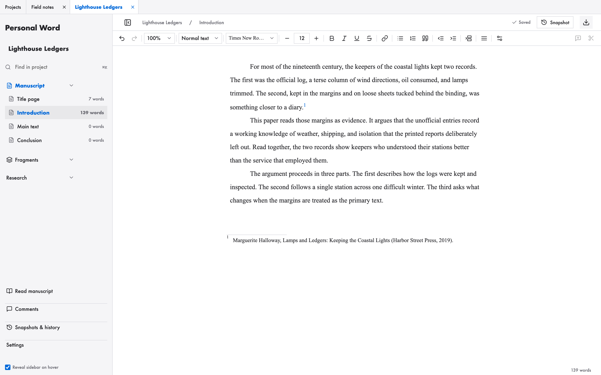
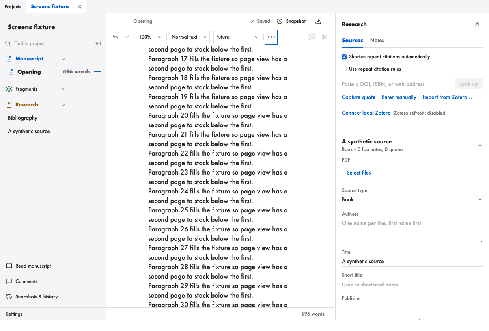
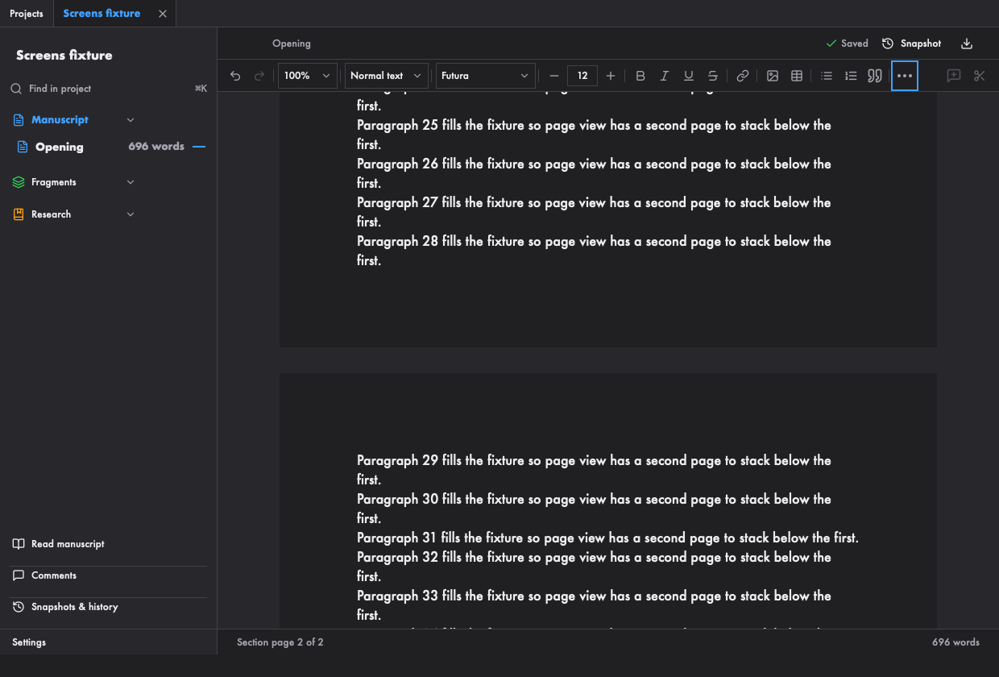
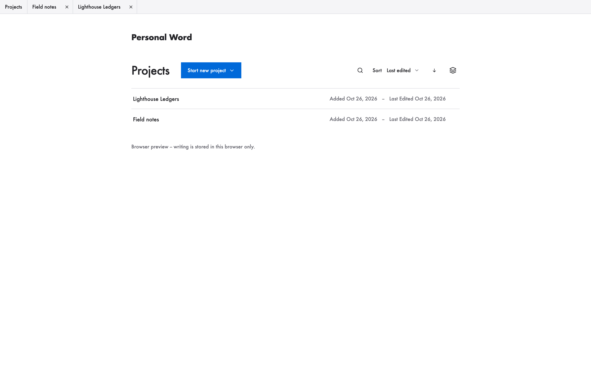

# Personal Word

**Free, open-source writing software for writers.** Organize a book, build a paper around your sources, and take your draft all the way to Word or PDF — on your own Mac.

I wanted writing software built for writers, and the prominent options all had a cost barrier. I built Personal Word to make a focused writing workspace freely available. No subscription or account: the source is here to inspect, change, and share under the GPL.

[Download for Mac](https://github.com/ECMSiegel/Personal-Word/releases/latest) · [Getting started](#quick-start) · [User guide](docs/user-guide.md) · [Contribute](CONTRIBUTING.md)



## Features

**Built for long pieces, not single pages**
- **Write in sections.** My manuscript is a list of sections in the sidebar. I open one at a time, reorder them by dragging, and never scroll through 80 pages to find a paragraph.
- **Fragments.** When I cut a passage I am not sure about, it goes to Fragments instead of disappearing. I can put it back into a section later.
- **Two things side by side.** I can open two sections, a fragment, or a source's PDF next to the draft, each in its own pane with its own page count and word count.
- **Real pages when I want them.** Switch between continuous writing and page view, adjust indents with the ruler, and set paper size and margins. Footnotes appear below the page text. Editor pages and exported pagination use different layout engines, so page breaks can differ.

**Research lives next to the writing**
- **Sources in the same window.** I paste a DOI, ISBN or web address and Personal Word looks the source up. I can also enter it by hand or import from Zotero (CSL JSON or BibTeX).
- **Chicago footnotes without the fuss.** "Cite here" drops a numbered footnote in the right Chicago 18 format. Later citations of the same source shorten automatically, and the bibliography builds itself.
- **Quotes with their page numbers.** "Capture quote" saves a passage with its page and inserts the quotation and the citation together.
- **PDFs beside the draft.** Upload a standalone PDF or attach one to a source, then read it in the second pane while you write.

**Safe with my work**
- **Saves as I type**, with crash recovery.
- **Snapshots and history.** Before a big revision I take a snapshot. I can compare versions side by side and restore one section or a single paragraph.
- **Mine, on my Mac.** No account, no subscription, no cloud. The only time it touches the internet is when I ask it to look up a citation.
- **Easy to get out.** Word (with real footnotes), PDF, Markdown and plain text exports, plus a full-project backup file.

**Calm to write in**
- A quiet, flat design that follows macOS light and dark mode, with a Plain or Color palette.
- A command palette for finding actions, a resizable sidebar, and optional floating sidebar and citation card when the margins have room.
- Focus mode dims everything but the paragraph I'm writing and hides the toolbar until I reach for it.
- Word and daily goals with a deadline, an optional on-device prose check, and keyboard shortcuts I can change.

| My sources beside the draft | Page view in dark mode |
| --- | --- |
|  |  |

### Project library



Keep separate writing projects together, then open the manuscript you want to work on.

## Quick start

**You need a Mac running macOS 15 or later.**

**Download it.** Get the `.dmg` from the [latest release](https://github.com/ECMSiegel/Personal-Word/releases/latest), open it, and drag **Personal Word** into Applications. The download is built for Intel; on Apple silicon it needs Rosetta, and I haven't tested that yet. The app isn't signed by Apple yet, so macOS blocks it the first time. Try to open it, then go to **System Settings > Privacy & Security** and choose **Open Anyway**.

**Or build it from source:**

1. **Install the tools.** Install [Node.js 22](https://nodejs.org) and [Rust](https://rustup.rs). Then open **Terminal** and install Apple's command line tools if you don't have them:

   ```sh
   xcode-select --install
   ```

2. **Download and run it.** In Terminal, one line at a time:

   ```sh
   git clone https://github.com/ECMSiegel/Personal-Word.git
   cd Personal-Word
   npm ci
   npm run tauri dev
   ```

   The first launch takes a few minutes while it builds. When the window opens, choose **Start new project**, then **Chicago**, and start writing.

3. **Make a real app (optional).** Stop the command above with **Control+C**, then:

   ```sh
   npm run tauri build
   open src-tauri/target/release/bundle/macos
   ```

   Drag **Personal Word.app** into Applications. It isn't signed by Apple yet, so the first time you open it macOS may warn you. If it does, allow it under **System Settings > Privacy & Security**.

The [user guide](docs/user-guide.md) walks through a whole paper: projects, sections, sources, citations, snapshots and export.

## Good to know

- **It's beta.** I use it for real writing, but keep your own backups. The download icon at the top right saves a complete copy of a project. Known gaps are listed in [Limitations](docs/limitations.md).
- **Mac only.** Windows, Linux, iPad and phones are not supported.
- **Where it keeps your writing:** each project is a folder in the Mac's app-data area (look under `com.folio.writing`). **Settings > Show path** shows the exact folder. To back up, quit the app and copy the folder.
- **What it isn't:** a full replacement for Microsoft Word. There are no tracked changes, live collaboration or merged table cells.

## For developers

Tauri 2, React, TypeScript, the Tiptap editor, and Rust with SQLite. How to run the tests, the architecture and how saving works are in [Developing Personal Word](docs/development.md). See also [Contributing](CONTRIBUTING.md), the [changelog](docs/changelog.md) and the [validation record](docs/validation.md).

## Open source, and open to contributions

Personal Word is free software under **GPL-3.0-only**. You can study the code, adapt it, and redistribute it under that license. Bug reports, writing-workflow feedback, documentation, and code contributions all help; start with [Contributing](CONTRIBUTING.md).

## License

Free and open source under GPL-3.0-only. See [LICENSE](LICENSE) and the [third-party notices](THIRD_PARTY.md).
