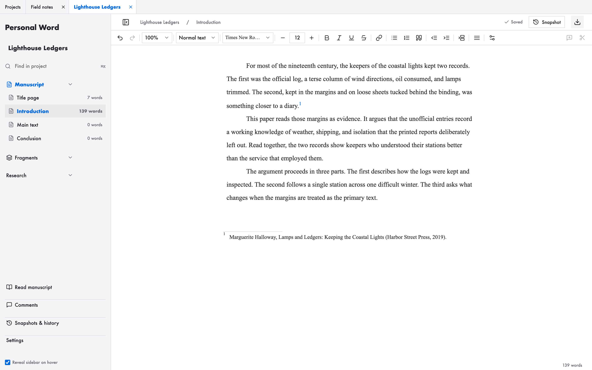
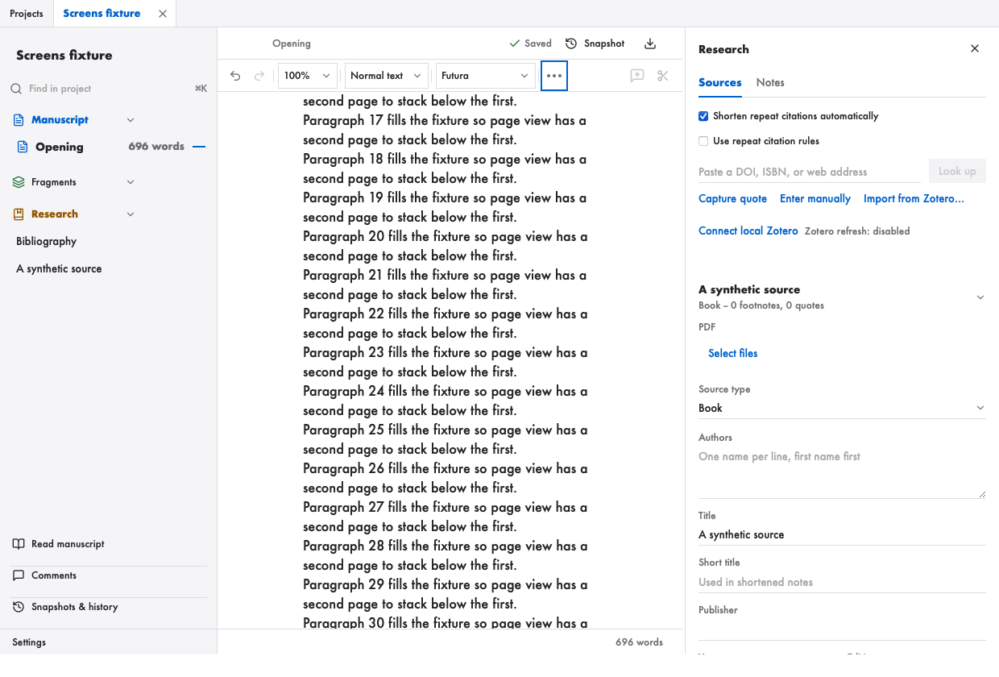
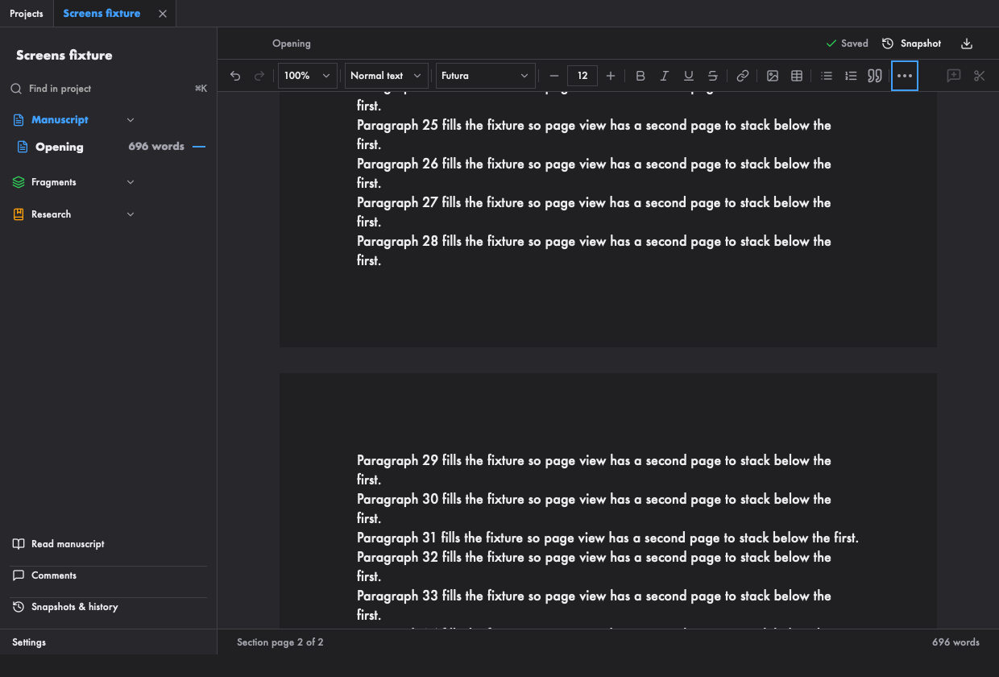
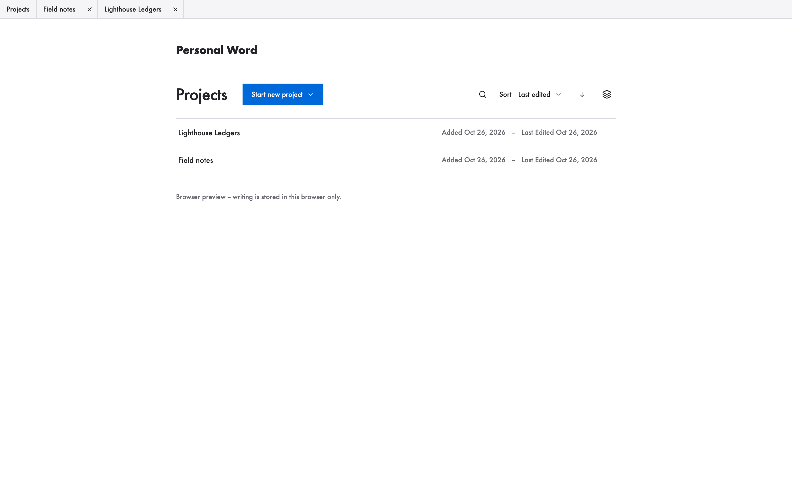

# Personal Word

**A private writing app for the Mac, built for research papers.** Write in sections, keep your sources beside the draft, insert Chicago-style footnotes, and export to Word or PDF. Your writing is stored on your Mac. Citation lookup is optional and contacts external services.

## Quick start

**You need a Mac.** There is no app download yet; these steps run Personal Word from source.

### 1. Install the prerequisites

Install [Node.js 22](https://nodejs.org) and [Rust](https://rustup.rs). Then open **Terminal** and install Apple's command line tools if you do not already have them:

```sh
xcode-select --install
```

Wait for installation to finish before continuing.

### 2. Download and run

Run these commands in Terminal, one line at a time:

```sh
git clone https://github.com/ECMSiegel/Personal-Word.git
cd Personal-Word
npm ci
npm run tauri dev
```

The first launch compiles the app and can take a few minutes. When the window opens, choose **Start new project**, then **Chicago**, and start writing. Keep Terminal open while using this development version.

### 3. Build a standalone app (optional)

Close the app and press **Control+C** in Terminal to stop the development command, then run:

```sh
npm run tauri build
open src-tauri/target/release/bundle/macos
```

The folder contains **Personal Word.app**, which you can copy to Applications. It is unsigned and not notarized, so macOS may warn you when opening it.

For a browser-only preview, run `npm run dev` and open `http://localhost:1420`. **Browser writing is stored separately from the Mac app's database.**

> **Beta.** Personal Word is early software for local writing; keep your own backups and see [Status, limits and history](#status-limits-and-history).



## Who it is for

Personal Word is for someone writing a long piece with sources: a student paper, a thesis chapter, an essay, or a book-length draft. It suits writers who:

- cite in **Chicago notes and bibliography** style, or follow a Turabian-style student paper layout;
- want their research notes, quotations, and sources **in the same window** as the draft;
- want their writing **stored on their own Mac**, with no account, subscription, or cloud service.

It also includes a screenplay template; projects created from the older Story and Essay templates still open. It is not a replacement for Microsoft Word. It supports inline images (PNG, JPEG), tables (with header rows, row/column operations), Chicago notes, comments, and project archives. It does not handle arbitrary merged table cells, live multi-user collaboration, or tracked changes.

## What it looks like

| Sources and citations beside the draft | Dark mode follows macOS or your choice |
| --- | --- |
|  |  |



These screenshots come from the browser preview, using made-up writing. The installed Mac app uses Apple's WebKit engine, so small rendering details can differ.

## Supported platform

| | |
| --- | --- |
| **Supported** | macOS only |
| **Tested on** | Intel macOS 15 automated checks; Intel and Apple silicon real-use checks confirmed by the owner ([results](docs/agent-work/2026-10-24-team-reconciliation/OWNER_TEST_RESULTS.md)) |
| **Not yet hand-tested** | Older macOS versions |
| **Not supported** | Windows, Linux, iPad, phones |

There is no downloadable app. Building from source produces `Personal Word.app`. The build is not signed or notarized by Apple, so macOS may warn you the first time you open it.

Distribution preparation is recorded in [Mac distribution status](docs/distribution.md); see also the [third-party notices](src-tauri/resources/THIRD_PARTY_NOTICES.txt).

## A short workflow

1. **Start a project.** On the Projects screen, choose **Start new project**, then **Chicago**. The template sets 12-point serif type, double spacing, one-inch margins, and a title page. Blank and Screenplay are offered too; Essay and Story are hidden from the menus, and projects already created from them still open.
2. **Write in sections.** The sidebar lists the paper's sections. Click one to open it, and add more with the **+** button beside Manuscript.
3. **Add a source.** Open **Research** in the sidebar. Paste a DOI, ISBN, or web address and choose **Look up**, choose **Enter manually**, or import a local Zotero **CSL JSON** or **BibTeX** (.bib) export. Review the preview before adding sources. The panel shows the Chicago note and bibliography entry as you type.
4. **Cite it.** Put the cursor where the note belongs and choose **Cite here**. A numbered footnote appears in the text and at the bottom of the page. New projects shorten repeated citations automatically; existing projects keep that option off until enabled. Choose a Short title and override a note to Always full or Always short when needed. **Capture quote** saves a passage with its page and can insert both quotation and citation together.
5. **Take a snapshot.** Before a big revision, choose **Snapshot** at the top right and name it. **Snapshots & history** lets you compare versions side by side and restore a section or a single paragraph.
6. **Export.** Open **Settings** in the sidebar and scroll to **Export document**. Choose **Export DOCX** for an editable Word file with real footnotes, or **Export PDF**. **Export Markdown** and **Export plain text** include the whole project, including notes, fragments, and research notes. **Markdown with images (.zip)** adds the pictures and a checksum manifest, and can be imported again.

**Bibliography.** The Research part of the sidebar lists **Bibliography** and then every source. The Bibliography page is read-only: choose the entry order (Alphabetical by author, Order first cited, By source type) and whether to include uncited sources. The choice is saved with the project and used by Word, PDF, Markdown and plain-text export. **Read manuscript** ends with the same Bibliography.

**PDFs.** Attach a PDF (up to 25 MB) to a source in Research and open it beside the draft. PDFs are stored in the project folder and are never fetched from the internet; they are not carried inside the project's `.json` archive or the Markdown bundle (see [Limitations](docs/limitations.md)).

**Open a section or a fragment beside the draft.** Cmd+click its sidebar row, or use the **Open beside** button that appears on hover or keyboard focus. Drag the divider to change the split; the width ratio is remembered, and each pane edits its own entry, so you can type in both.

The **Projects** screen has a search button that opens a field and filters the list by title. **Start new project** opens a panel listing the templates, then **Import a file…** and **Recover from a project.json file…**. You can also drag one `.txt`, `.md`, `.docx`, `.html` or `.zip` file onto the Projects screen to open the import preview; Cancel creates nothing.

**Appearance:** in **Settings > General**, choose Appearance (System, Light or Dark) and Palette (Plain or Color). Cmd/Ctrl+Shift+L switches between Light and Dark. System follows macOS live; Color adds section tints in the sidebar and colored buttons without changing the document area.

Set manuscript/daily word goals and a deadline in **Settings > Goals**. The toolbar offers **Focus mode** (Cmd/Ctrl+Shift+F) and an optional local **Prose check** with a keyboard-accessible issue list.

The app saves as you type. The download icon at the top right saves a complete copy of the project as a `.json` file, which is useful as a backup.

## Where your writing lives

Each project is stored in its own folder in your Mac's application-data area, under the name `com.folio.writing`. In **Settings**, choose **Show path** next to Storage location to see the exact folder. Each folder holds a SQLite database, which is the real copy, plus readable JSON and plain-text copies.

To back up, quit the app and copy the whole project folder somewhere else. The only time the app uses the internet is when you choose **Look up** for a citation. It sends the DOI or ISBN you entered to Crossref or Open Library, or fetches the web page you named. A DOI found in that page’s metadata may trigger a follow-up request to Crossref. The optional Zotero refresh (off by default) talks only to Zotero on your own Mac.

## Beta status

Personal Word 0.1.1 is **beta**. Gate D passed automated acceptance, and on 2026-10-25 the owner confirmed personally completing all nine real-use checks successfully. Those owner gates are VERIFIED by owner report. See the [owner results](docs/agent-work/2026-10-24-team-reconciliation/OWNER_TEST_RESULTS.md) for the confirmation and its scope, and the [validation record](docs/validation.md) for automated counts, run IDs and binary hashes.

The nine checks covered keyboard editing and comment navigation, blocked-close retry, recovered images, pre-restore safety copies, Microsoft Word rendering, Apple silicon, VoiceOver and input methods, a long writing session, and native WebKit light/dark visuals. See the [roadmap](ROADMAP.md) for future work.

## For developers

- [Architecture and how saving works](docs/architecture.md)
- [Feature guide](docs/personal-word-v2.md)
- [Validation record](docs/validation.md)
- [Contributing](CONTRIBUTING.md) and [security reporting](SECURITY.md)
- [Third-party licenses](THIRD_PARTY.md)

The app uses Tauri 2, React, TypeScript, the Tiptap editor, and Rust with SQLite. Run the checks with:

```sh
# Recorded qualification used Node v22.23.3. If available locally:
export PATH="$PWD/node_modules/.cache/personal-word-alpha-review/tools/node-v22.23.3-darwin-x64/bin:$PATH"
node --version
npm run build
npm test -- --no-file-parallelism --maxWorkers=1
PLAYWRIGHT_PREVIEW=1 npm run test:e2e -- --workers=1
cargo test --locked --offline --manifest-path src-tauri/Cargo.toml --jobs 1 -- --test-threads=1
```

Without `PLAYWRIGHT_PREVIEW=1`, `npm run test:e2e` starts the development server. The board qualified the production preview only; build first as above. The pinned Node path is a local cache, not included in a fresh clone; otherwise install Node v22.23.3 separately to reproduce that runtime.

For the isolated native beta checks, build the diagnostic app first, then run the two suites serially:

```sh
npm run tauri build -- --debug --features native-smoke --no-bundle --config '{"identifier":"com.folio.smoke"}'
python3 scripts/native-reliability.py --suite baseline
python3 scripts/native-reliability.py --suite beta
python3 scripts/verify-beta-evidence.py --evidence docs/agent-work/2026-10-20-beta-roadmap/06-durability/EVIDENCE.json --source-manifest docs/agent-work/2026-10-20-beta-roadmap/06-durability/SOURCE_MANIFEST.json
```

The evidence verifier checks recorded evidence and source identity; it does not run the suites. Exit 0 means the recorded evidence and owner reports are consistent; exit 2 means required outcomes are incomplete. Local evidence/build artifacts are required and are not shipped in Git. Rebuild the normal app without diagnostic features before owner testing.

Some internal names still say `folio`, from the app's earlier name. They keep existing projects readable. Do not rename them without a data migration.

## License

GPL-3.0-only. See [LICENSE](LICENSE).

## Status, limits and history

- [Limitations](docs/limitations.md) -- current limitations, then resolved issues with dates
- [Changelog](docs/changelog.md) -- full dated history
- [Validation record](docs/validation.md) -- how it was checked
