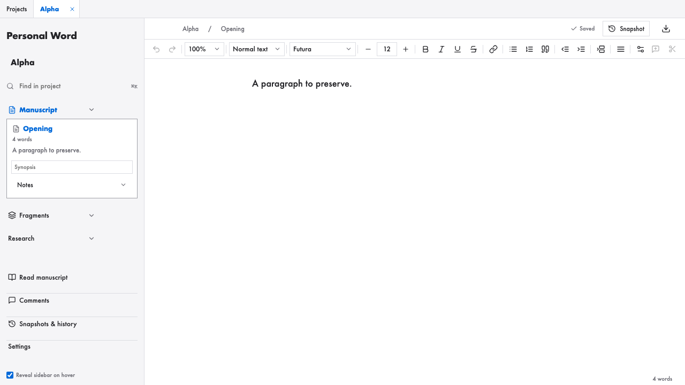

# Personal Word

Personal Word is an early, Mac-first writing app for local projects. It combines a Tauri 2 desktop shell, a React and TypeScript interface, a Tiptap editor, and Rust/SQLite storage. This is alpha software: core writing, import, export, and local recovery workflows are implemented, and the current unit, browser, Rust, and isolated native checks pass. What remains is interactive review on a real desktop session -- native light/dark screenshots, VoiceOver, IME and rich paste, native file dialogs, Word's own rendering of exported DOCX, and the owner's confirmation -- so this is not a production durability certification or a signed, notarized release. See the [validation record](docs/validation.md) for exact evidence and remaining checks.



Current Chromium preview using synthetic writing; this is not native WebKit visual verification.

## What works

- Create projects from templates; reopen, rename, and organize projects and tabs.
- Write with headings, common text formatting, lists, links, comments, and footnotes. Organize a manuscript into sections and fragments, search it, and inspect or restore earlier versions.
- Save locally to SQLite with recovery journals and named snapshots. Export project JSON or manuscript text; import UTF-8 `.txt` or Markdown (`.md`, `.markdown`) files up to 5 MB as new projects after a preview.
- Keep research notes and sources, get Chicago-style citation assistance, and look up a typed DOI, ISBN, or web address on request.
- Export DOCX or PDF and preview PDF. Read-view and editor page layout are available.

This is a focused writing workspace, not a general Word replacement. Import accepts UTF-8 `.txt` and Markdown up to 5 MB and previews the result before creating anything; images, tables, and raw HTML from Markdown arrive as literal text, and no remote resource is fetched. PDF draws with bundled open-source Noto font subsets covering Latin, Latin Extended, Greek, and Cyrillic, does not shape other scripts or use the fonts installed on the Mac, and rejects unsupported glyphs or footnotes that cannot fit on a page. Editor, DOCX, and PDF pagination use separate layout engines, so page breaks may differ. Citation assistance covers common source types; verify citations and instructor-specific formatting yourself. Cloud sync, collaboration, images, and advanced tables are not provided.

## macOS development

Use macOS with Node.js 22 LTS (the CI version), Rust and Cargo, and Apple's Xcode Command Line Tools. Then install the locked JavaScript dependencies and run the desktop app:

```sh
npm ci
npm run tauri dev
```

`npm run dev` starts a browser preview at `http://localhost:1420`. Its browser storage is separate from native SQLite; preview data and browser tests do not verify desktop persistence.

Useful project commands:

```sh
npm run build
npm test
npm run test:e2e
cargo test --manifest-path src-tauri/Cargo.toml
npm run tauri build
```

The native bundle is written under `src-tauri/target/release/bundle/macos/Personal Word.app`. Building it does not sign or notarize it for distribution. See [validation notes](docs/validation.md) for dated results and the checks that remain incomplete.

## Your writing and recovery

Native project data is stored under the macOS application-data directory for `com.folio.writing`; **Settings → Local storage** shows the actual path. Each project has a SQLite database plus portable JSON and text copies. SQLite is authoritative. Portable copies may lag briefly while the app is open, and a visible saved state does not guarantee protection from a power cut or forced process termination.

Quit the app before making an external backup, then copy the whole project folder to another storage device or backup service. For recovery steps, database layout, journal behavior, and known limits, see [architecture](docs/architecture.md) and the [feature guide](docs/personal-word-v2.md). Do not rename the historical `com.folio.writing` identifier or `folio.*` storage keys without a data migration; they preserve access to existing projects.

## Project notes

- [Architecture and persistence boundaries](docs/architecture.md)
- [Feature guide and limitations](docs/personal-word-v2.md)
- [Validation record](docs/validation.md)
- [Application history](docs/app-history.md)
- [Roadmap](ROADMAP.md)
- [Publication readiness](docs/publication-readiness.md)
- [Third-party license inventory](THIRD_PARTY.md)
- [Contributing](CONTRIBUTING.md)
- [Security reporting](SECURITY.md)
- [GNU General Public License v3.0](LICENSE)

The project is licensed under GPL-3.0-only; see [LICENSE](LICENSE).
