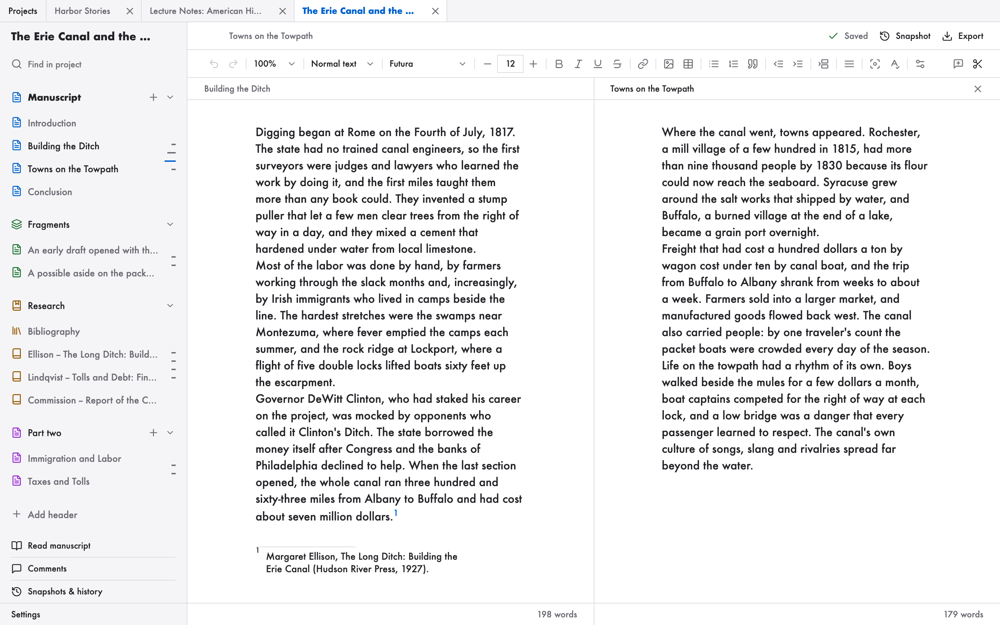
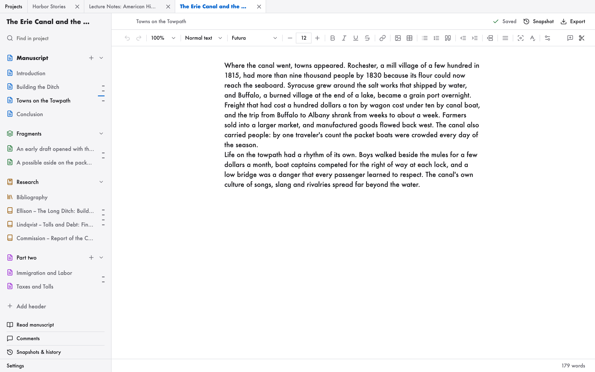
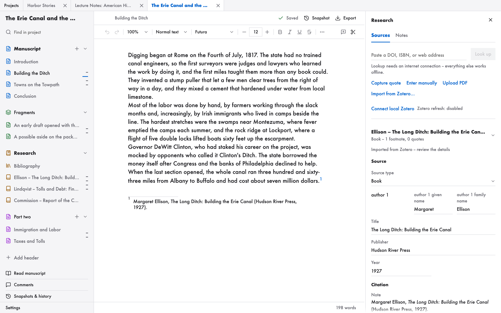
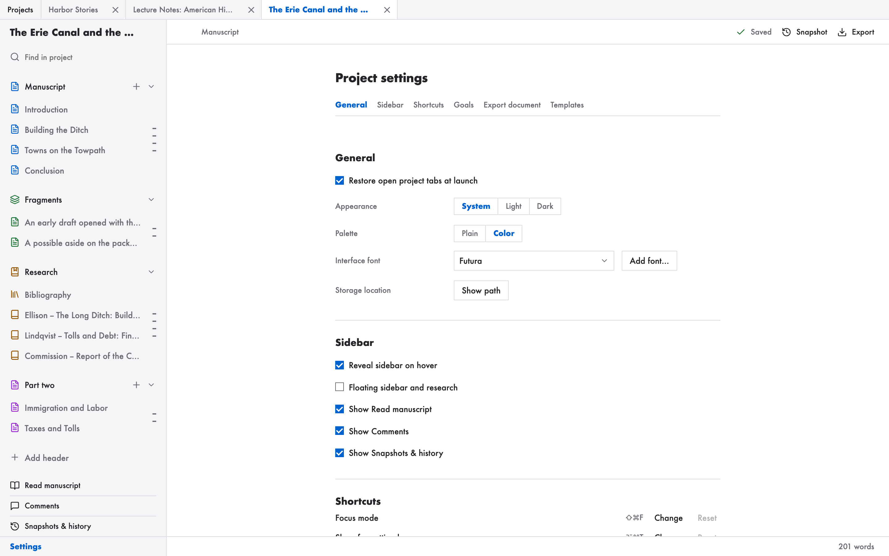
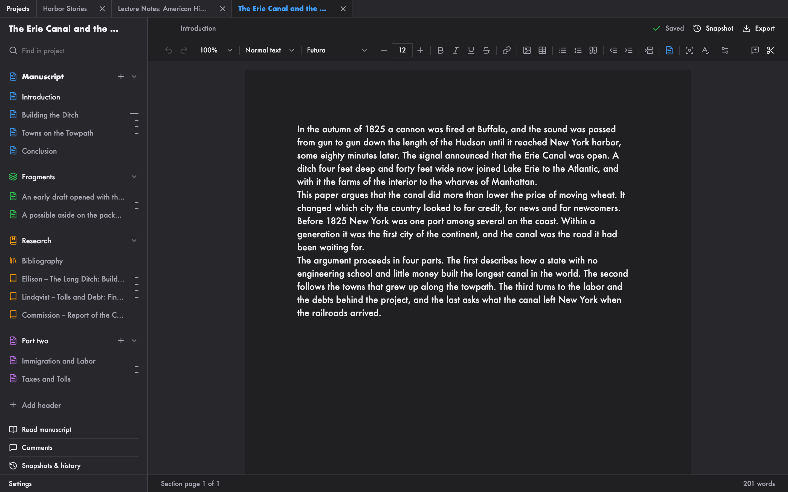
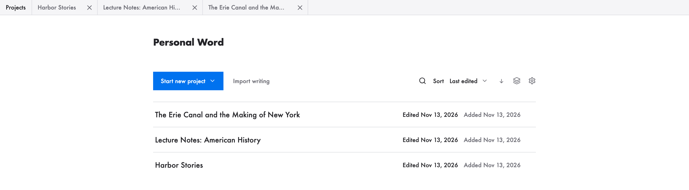

# Personal Word

**Free, open-source writing software for writers.** Organize a book, build a paper around your sources, and take your draft all the way to Word or PDF — on your own Mac.

I wanted writing software built for writing. Docs excels in collaborative environments, but stopped meeting my needs for long term projects. The other prominent options had a prominent cost barrier. I built Personal Word to make a focused writing workspace freely available. Personal Word is easy to personalize; change the interface based to help with your goals, not mine. No subscription or account: the source is here to inspect, change, and share under the GPL.

[Download for Mac](https://github.com/ECMSiegel/Personal-Word/releases/latest) · [Getting started](#quick-start) · [User guide](docs/user-guide.md) · [Contribute](CONTRIBUTING.md)



## Features

### Two panes, side by side
- **Split view.** Two sections open next to each other, each pane editing its own section and keeping its own footer with page count and word count.
- **Open beside.** A section, a fragment or a source's PDF opens in a second pane from the **Open beside** button on its sidebar row, from its right-click menu, or with Cmd+click.
- **A source beside the draft.** An attached or uploaded PDF reads in the right pane while the draft stays editable in the left.
- **A fragment beside a section.** A fragment opens next to the section being written, ready to copy back.
- **Adjustable divider.** Dragging the divider changes the split, and the ratio is remembered.
- **Steady panes.** Opening or closing a split keeps the left pane's undo history and scroll position, and both panes line their pages up under matching title bars.

### Built for long pieces

- **Write in sections.** The manuscript is a list of sections in the sidebar. A section opens on its own, and dragging reorders it.
- **Headers.** Manuscript, Fragments and Research are headers, and more can be added beside Manuscript (for example "Part two"). Sections inside a header stay part of the manuscript, so Read and exports follow the sidebar order.
- **Fragments.** A passage cut from a section goes to Fragments instead of disappearing.
- **Real pages when needed.** Page view stacks a section as pages, with indents on the ruler, paper size and margins, and footnotes below the page text. Editor pages and exported pagination use different layout engines, so page breaks can differ.

### Research next to the writing

- **Sources in the same window.** A DOI, ISBN, PubMed link or web address is looked up for the source's details. Sources can also be entered by hand or imported from Zotero (CSL JSON or BibTeX).
- **Chicago footnotes.** "Cite here" drops a numbered footnote in Chicago 18 form. Later citations of the same source shorten automatically, and the bibliography builds itself.
- **Quotes with their page numbers.** "Capture quote" saves a passage with its page and inserts the quotation and the citation together.
- **PDFs.** A standalone PDF can be uploaded, or one attached to a source, then opened beside the draft.

### Made to be adjusted

- **Highly Customizable.** Change the interface font, colors, spacing, and organization according to your needs, instead of being locked in to what works for me.
- **Interface font.** Any font installed on the Mac, or added from `.ttf` and `.otf` files, sets the font of the whole interface.
- **Appearance.** System, Light or Dark; Cmd+Shift+L switches between Light and Dark.
- **Palette.** Plain, or Color, which tints the sidebar icons and buttons without changing the document area.
- **Headers.** Every header takes its own icon colour, per project, from a row of swatches in its right-click menu (Color palette). Headers can also be renamed and moved up or down, and added ones deleted.
- **Sidebar.** Resizable and pinnable, with a list or card view for each group, optional reveal on hover, and an optional floating mode that places the sidebar and the citation card in the page margins when they are wide enough.
- **Toggle-able focus mode.** Dims everything but the current paragraph and hides the toolbar until it is needed.

**The page**
- **Page setup.** Paper size, page margins and page numbers, plus a top ruler and a side ruler that can each be switched on or off.
- **Type and spacing.** Typeface, size, line spacing, space after paragraphs and zoom.
- **Reading view.** Read manuscript has its own font, size and line spacing, separate from export formatting.
- **Templates.** Blank, Chicago and Screenplay set the starting page layout.

**Working habits**
- **Goals.** A word goal for the manuscript, a daily goal and a deadline.
- **Prose check.** An optional on-device check with a switch for each rule.
- **Shortcuts.** Rebindable keyboard shortcuts, listed in Settings, and a command palette (Cmd+Shift+P) for finding any action.
- **Launch.** Open project tabs can be restored at launch, or the app can open on the Projects screen.

### Safe with the work
- **Saves while typing**, with crash recovery.
- **Snapshots and history.** A snapshot before a big revision can be compared side by side, and one section or a single paragraph restored.
- **Local only.** No account, no subscription, no cloud. The only time it reaches the internet is a citation lookup; the optional Zotero refresh talks only to Zotero on the same Mac.
- **Easy to get out.** Word (with real footnotes), PDF, Markdown and plain text exports, plus a full-project backup file.



### Project library



Separate writing projects live together on one screen, searchable and sortable, as one outline list with folders, sortable columns and up to three pinned items.

## Quick start

**You need a Mac running macOS 15 or later.**

**Download it.** Get the `.dmg` from the [latest release](https://github.com/ECMSiegel/Personal-Word/releases/latest), open it, and drag **Personal Word** into Applications. The download is built for Intel; on Apple silicon it needs Rosetta, and I haven't tested that yet. The app isn't signed by Apple yet, so macOS blocks it the first time. Try to open it, then go to **System Settings > Privacy & Security** and choose **Open Anyway**.

**Or build it from source:**

1. **Install the tools.** Install [Node.js 22](https://nodejs.org) and [Rust](https://rustup.rs). Then open **Terminal** and install Apple's command line tools if you don't have them:

   ```sh
   xcode-select --install
   ```

2. **Download and run it.** In Terminal, one line at a time:

   ```sh
   git clone https://github.com/ECMSiegel/Personal-Word.git
   cd Personal-Word
   npm ci
   npm run tauri dev
   ```

   The first launch takes a few minutes while it builds. When the window opens, choose **Start new project**, then **Chicago**, and start writing.

3. **Make a real app (optional).** Stop the command above with **Control+C**, then:

   ```sh
   npm run tauri build
   open src-tauri/target/release/bundle/macos
   ```

   Drag **Personal Word.app** into Applications. It isn't signed by Apple yet, so the first time you open it macOS may warn you. If it does, allow it under **System Settings > Privacy & Security**.

The [user guide](docs/user-guide.md) walks through a whole paper: projects, sections, sources, citations, snapshots and export.

## Good to know

- **It's beta.** I use it for real writing, but keep your own backups. The download icon at the top right saves a complete copy of a project. Known gaps are listed in [Limitations](docs/limitations.md).
- **Mac only.** Windows, Linux, iPad and phones are not supported.
- **Where it keeps your writing:** each project is a folder in the Mac's app-data area (look under `com.folio.writing`). **Settings > Show path** shows the exact folder. To back up, quit the app and copy the folder.
- **What it isn't:** a full replacement for Microsoft Word. There are no tracked changes, live collaboration or merged table cells.

## For developers

Tauri 2, React, TypeScript, the Tiptap editor, and Rust with SQLite. How to run the tests, the architecture and how saving works are in [Developing Personal Word](docs/development.md). See also [Contributing](CONTRIBUTING.md), the [changelog](docs/changelog.md) and the [validation record](docs/validation.md).

## Open source, and open to contributions

Personal Word is free software under **GPL-3.0-only**. You can study the code, adapt it, and redistribute it under that license. Bug reports, writing-workflow feedback, documentation, and code contributions all help; start with [Contributing](CONTRIBUTING.md).

## License

Free and open source under GPL-3.0-only. See [LICENSE](LICENSE) and the [third-party notices](THIRD_PARTY.md).
